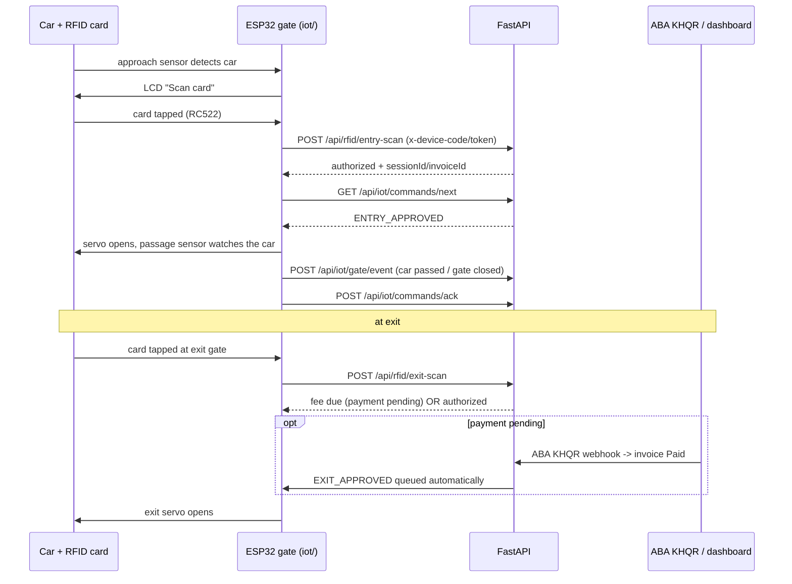

# Real IoT device integration (RFID gates + FastAPI)

The **dashboard** (Nuxt) is for staff: parking history, invoices, payment
display (KHQR only), analytics, and **RFID card management** (`/rfid` page —
register cards, block/unblock, scan history, gate command activity).

**Gate hardware** is the ESP32 firmware in `iot/` (Arduino C++ / PlatformIO).
The camera/OpenCV OCR entry path and the Wokwi MicroPython simulator were
removed — RFID cards are the entry/exit identity now.

## Architecture



## Device registry (seeded in `app/core/bootstrap.py`)

| device_code | device_type | token (.env) | Used by |
|-------------|-------------|--------------|---------|
| ENTRY_GATE_01 | ENTRY_GATE | `IOT_ENTRY_DEVICE_TOKEN` | entry ESP32 (`-e entry_gate`) |
| EXIT_GATE_01 | EXIT_GATE | `IOT_EXIT_DEVICE_TOKEN` | exit ESP32 (`-e exit_gate`) |
| GATE_SIM_01 | GATE_SIM | `IOT_ENTRY_DEVICE_TOKEN` | simulator/manual test lanes |
| CAMERA_ENTRY_01 / PRINTER_01 | CAMERA / PRINTER | `IOT_ENTRY_DEVICE_TOKEN` | legacy registry rows |

Every IoT HTTP call must include:

```http
x-device-code: EXIT_GATE_01
x-device-token: secret-exit-token
```

## RFID identity layer

| Table | Purpose |
|-------|---------|
| `rfid_cards` | registered cards: `card_uid` → `license_plate`, `vehicle_type`, `label`, `status` (`Active`/`Blocked`), `last_used_at` |
| `rfid_scan_events` | full scan audit: every presentation at entry/exit, accepted or rejected, with reason |

**SECURITY:** a MIFARE UID is an identifier, not a secret (clones exist).
This is acceptable for the local/educational deployment; production needs a
second factor (staff presence, PIN, secure-element cards). See the root
README security notes.

## Device endpoints

| Method | Path | Used by |
|--------|------|---------|
| POST | `/api/rfid/entry-scan` | entry ESP32 — `{deviceCode, cardUid}` |
| POST | `/api/rfid/exit-scan` | exit ESP32 — `{deviceCode, cardUid}` |
| GET | `/api/iot/commands/next?deviceCode=` | ESP32 long-poll for gate commands |
| POST | `/api/iot/commands/ack` | ESP32 acknowledges `completed`/`failed` + detail |
| POST | `/api/iot/gate/event` | `entry_car_passed`, `exit_gate_closed`, `gate_fault`, … |
| POST | `/api/iot/heartbeat` | ESP32 keep-alive (shows device online on dashboard) |
| GET | `/api/iot/session-status?sessionId=` | exit station poll until `canOpenGate` |
| POST | `/api/iot/open-gate` | operator/manual open — only when session Completed + Paid |

Scan responses always use HTTP 200 with a decision body:
`authorized`, `paymentPending` + `amount`, `duplicate`, or `success: false`
+ `message` for denials.

## Management endpoints (dashboard; optional `RFID_ADMIN_TOKEN`)

| Method | Path | Purpose |
|--------|------|---------|
| GET | `/api/rfid/cards?search=&status=` | list/search cards |
| POST | `/api/rfid/cards` | register `{cardUid, licensePlate, vehicleType, label}` |
| POST | `/api/rfid/cards/{card_uid}` | update plate/type/label/`status` (block) |
| GET | `/api/rfid/scans?cardUid=&gate=&accepted=` | scan history |
| GET | `/api/rfid/gate-activity?deviceCode=&limit=` | recent commands + ack/expiry state |

When `RFID_ADMIN_TOKEN` is set in `.env`, these endpoints require the
`x-rfid-admin-token` header. Empty (default) = open for local development.

## Gate commands: delivery, acknowledgement, timeout

`device_commands` lifecycle: `pending → delivered → acked | failed`, and
`expired` when the command aged past `GATE_COMMAND_TIMEOUT_SECONDS` (default
180 s, aligned with the firmware `PARKING_COMMAND_VALIDITY_MS`).

- **delivered** — the device polled it.
- **acked/failed** — the device executed it (or could not) and posted the ack
  with a detail message.
- **expired** — never delivered/acked in time; a stale "open gate" approval
  can never execute later. Disconnected gates are visible via this state on
  the `/rfid` dashboard page.

## Edge software in this repo

| Path | Role |
|------|------|
| `iot/` | **ESP32 Arduino firmware** (PlatformIO) — see `iot/README.md` for wiring |
| `backend/devices/entry_station.py` | optional CLI manual entry lane (calls `/api/iot/entry-scan`) |
| `backend/devices/exit_station.py` | optional CLI manual exit lane (calls `/api/iot/exit-verify`) |
| `backend/devices/client.py` | shared HTTP client |

## Hardware checklist

- [ ] ESP32 flashed with `-e entry_gate` / `-e exit_gate` and secrets set
- [ ] RC522 wired on 3.3 V (SS 4, SCK 14, MOSI 23, MISO 19, RST 27)
- [ ] Passage safety sensor wired (TRIG 32 / ECHO 33) or disabled in config
- [ ] Cards registered on the dashboard `/rfid` page
- [ ] Backend reachable from the gate LAN (`--host 0.0.0.0`, firewall open)
- [ ] Device tokens in `parking_secrets.h` match `backend/.env`
- [ ] Exit gate: ABA KHQR webhook or Payment page verify reaches the invoice

## Security notes

- Default tokens (`secret-entry-token`, `secret-exit-token`) are dev-only.
- The dashboard never calls `/api/iot/*` device endpoints.
- RFID UIDs are not secrets — do not use this card layer as production
  authentication without an additional factor.
- `POST /api/gate/exit/mock-payment` is an **unauthenticated development
  helper** that marks an invoice paid. Remove/block it (reverse proxy or code)
  before any real deployment; production payments go through
  `/api/payment/webhook` with `x-webhook-secret` or `/api/payment/verify`.
- Set `RFID_ADMIN_TOKEN` in `.env` before exposing the dashboard beyond a
  trusted LAN so card registration/blocking requires `x-rfid-admin-token`.
